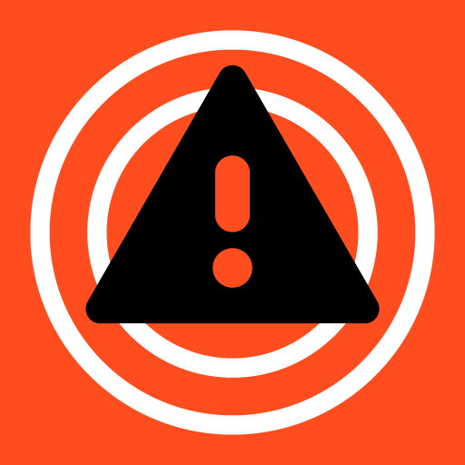
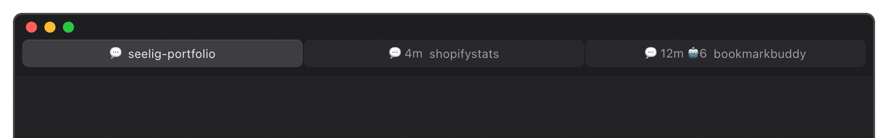

<h1 align="center">
   
  Radar for Claude Code
</h1>

<strong>💬 working&ensp;·&ensp;⚠️ needs you&ensp;·&ensp;🟢 done&ensp;·&ensp;🔴 failed&ensp;·&ensp;🤖 agents</strong>

  &emsp;&emsp;

**Claude Code multitasking, done right.** Run Claude across several projects and always know which one needs you, without clicking through window after window.

## Four features, one glance

- **Live status in every window title.** 💬 working, ⚠️ needs you, 🟢 done, 🔴 ended on a failed tool call. Every project, one look. A question Claude typed counts as ⚠️ too, so it doesn't sit unanswered behind a green marker.
- **Live agent count.** Claude fans out into subagents for a big review or a workflow? The title counts them while they run: `💬 14m 🤖8`.
- **Markers that clean up after themselves.** Interrupted with `Esc`, Claude quit, terminal closed? The marker goes, instead of claiming work that stopped ten minutes ago.
- **macOS banners and sounds.** A background window pings you when it needs you or finishes, one click jumps right in. The window you're looking at stays quiet.

## Tips

- **Native tabs are the killer setup.** Set `"window.nativeTabs": true` in your settings and restart: every window packs into one tab bar, a live status board for all your Claudes. Already have windows open? **Window → Merge All Windows** pulls them all into one bar. (Radar works without native tabs too: title bar, window switcher, Mission Control.)
- **Switch projects without the mouse.** Bind `workbench.action.showPreviousWindowTab` and `showNextWindowTab` to keys you like (`⌘←` / `⌘→` work nicely), and step straight to the Claude that needs you. Without native tabs, `` ⌘` `` cycles through the windows.
- **Presenting?** Run **Mute banners for 1 hour** from the Command Palette, sounds pause too and the markers keep working. For quiet by default, empty `claudeRadar.soundWaiting` / `soundDone` or turn `claudeRadar.banner` off.

## Requirements

- VS Code ≥ 1.93 · Claude Code · **macOS only**
- `terminal-notifier` (Homebrew) makes banners clickable; without it you still get notification + sound

## Setup

Radar offers to set itself up on first launch and keeps reminding you until it's done: **both steps are required, no marker shows without them.** If `terminal-notifier` is missing, it offers the Homebrew install too. Or do it via the Command Palette: **Add ${claudeRadarStatus} to window.title**, then **Install Claude hooks** (writes to `~/.claude/settings.json`, backup first, other hooks stay put). Claude loads hooks at session start, so restart any session that's already running. Updates keep the hooks current automatically. Uninstalling? Run **Remove Claude hooks** first, then uninstall.

## Privacy, performance & trust

- **No network, no telemetry.** Everything happens in local files.
- **Event-driven, not polling.** Idle cost is effectively zero. One exception: while a marker is on display, a light scan runs every 10 s (agent count, and whether a Claude is still alive here). With an empty title, the normal state, nothing runs at all.
- **Safe config writes.** Atomic, with a backup. Removal is one command.
- **Open source.** [Full code on GitHub](https://github.com/seeligmx/radar-for-claude-code).

## How it works

Six Claude hooks drop a file in `~/.claude/tab-status/`, named `sha256(project path)` (first 16 hex chars, realpath-resolved so symlinks match). The content is the status:

- `UserPromptSubmit` → `prompt` (shows `working`, purely visual, no banner/sound; its own label so a new prompt restarts the elapsed-time clock)
- `Notification` / `PermissionRequest` → `waiting`
- `PreToolUse` + `AskUserQuestion` → `waiting` (a question needs you too; its own hook, since AskUserQuestion fires neither Stop nor Notification)
- `PostToolUse` → `working` (every completed tool call flips back to working, so an answered question or a granted permission doesn't leave the title empty while Claude keeps going)
- `Stop` → `stop` (done, or ⚠️ when the turn ends by asking you something, or 🔴 when its last tool call failed), unless background work is still running, then `working` stays. Subagents, workflows, and monitors count as work (they finish and wake the session); background shell tasks don't, since a dev server Claude started would otherwise hold the working marker forever. Want shell tasks to count? Turn on `claudeRadar.shellTasksKeepWorking`.

Each window watches only its own file and shows the marker from **state + focus**:

- `working` stays visible the whole time, even in the active window, never with banner/sound, so nothing flickers.
- `needs you` / `done` show a persistent marker and banner only when the window's in the background (banner via `terminal-notifier`, a click focuses the right window). In the active window they flash for ~1 s ("peek") and fade.
- Focusing a window clears an attention marker; `working` stays, since Claude's still going.

While `working` shows, Radar also counts the subagents running in this project: Claude Code keeps one transcript file per agent under `~/.claude/projects/`, and a transcript written to within the last two minutes counts as a running agent (checked every 10 s, read-only). That's the 🤖8 in the title.

While a marker is on display, Radar also verifies it. Claude Code lists every running session in `~/.claude/sessions/<pid>.json` with its working directory; if no live process belongs to this project any more, the marker was lying and goes. The same pass reads the tail of the session transcript, which records two things no hook reports: an `Esc` interrupt (the marker goes, deliberately without a "done" marker, since nothing finished) and a failed tool call. Only the turn's *last* tool result counts for 🔴, so a failure Claude recovered from in the same turn still ends green. Measured across 1464 real turns, that marks 2 % of them.

Stale files (sessions with no matching window) are cleaned up after 24 h.

## Limits

- The marker is text (emoji) in the title, not a native tab badge, macOS doesn't allow those.
- `Stop` fires after every response. Fine for the marker and banner (idempotent, one banner per project, focused windows skipped).
- Interrupting Claude with `Esc` still fires no hook, so the marker clears on the next sweep (within 10 s) rather than instantly.
- Marker verification needs `~/.claude/sessions/`, which older Claude Code versions don't write. Without it Radar leaves every marker alone, exactly as before.
- 🔴 reports a failed *tool call*, not a failed task. Claude explaining that something can't be done ends green.
- Question detection reads the last non-empty line of Claude's closing text. A question phrased mid-paragraph, or one without a question mark, ends green. Measured across 1579 real turn endings, 4 % close on a question.
- The agent count reads transcript activity: an agent that goes silent for over two minutes (say, inside one long build command) drops out of the count until it writes again. Agents running in Anthropic's cloud leave no local transcripts and aren't counted.
- Multi-root workspaces: the first folder wins.
- Two events at once: the later one wins.

## Settings

Give just the symbol, the space is added for you. Empty means no marker for that status.

| Setting | Default | |
| --- | --- | --- |
| `claudeRadar.markerWorking` | `💬` | while Claude is working |
| `claudeRadar.showWorkingTime` | `true` | show the elapsed time in the working marker (`💬 14m`) |
| `claudeRadar.markerAgents` | `🤖` | prefix for the count of running subagents (`💬 14m 🤖8`); empty hides the count |
| `claudeRadar.markerWaiting` | `⚠️` | when Claude needs you |
| `claudeRadar.markerDone` | `🟢` | when Claude is done |
| `claudeRadar.markerError` | `🔴` | when the turn ended on a failed tool call |
| `claudeRadar.detectQuestions` | `true` | a turn ending in a question counts as ⚠️, not 🟢 |
| `claudeRadar.banner` | `true` | macOS banner on/off |
| `claudeRadar.minDoneSeconds` | `0` | only banner "done" when the turn ran this long (⚠️ and 🔴 always notify) |
| `claudeRadar.soundWaiting` | `Basso` | sound when needs you (empty = silent) |
| `claudeRadar.soundDone` | `Glass` | sound when done (empty = silent) |
| `claudeRadar.soundError` | `Basso` | sound when a turn ended on a failed tool call |
| `claudeRadar.shellTasksKeepWorking` | `false` | background shell tasks (e.g. a dev server) keep the working marker |
